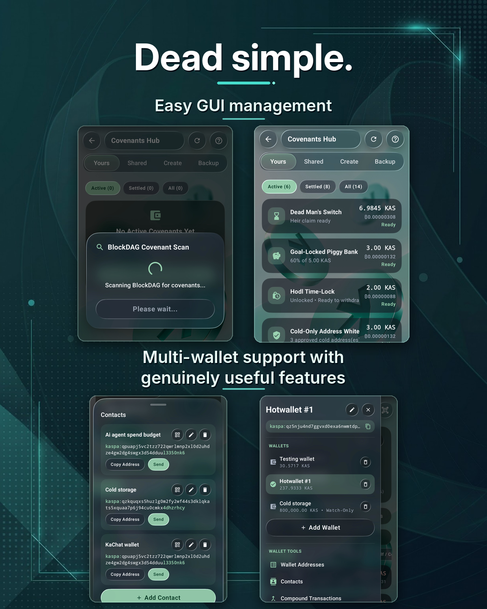
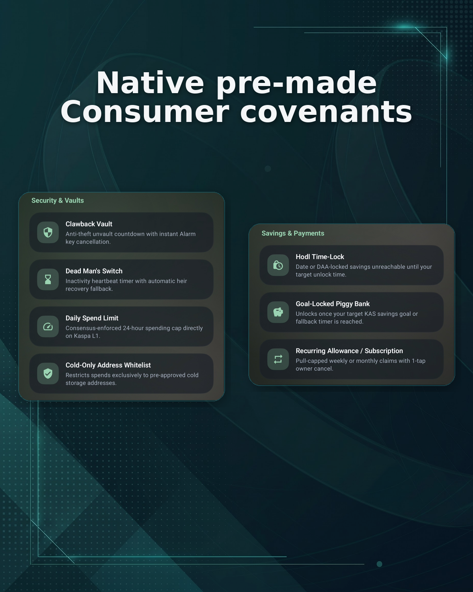
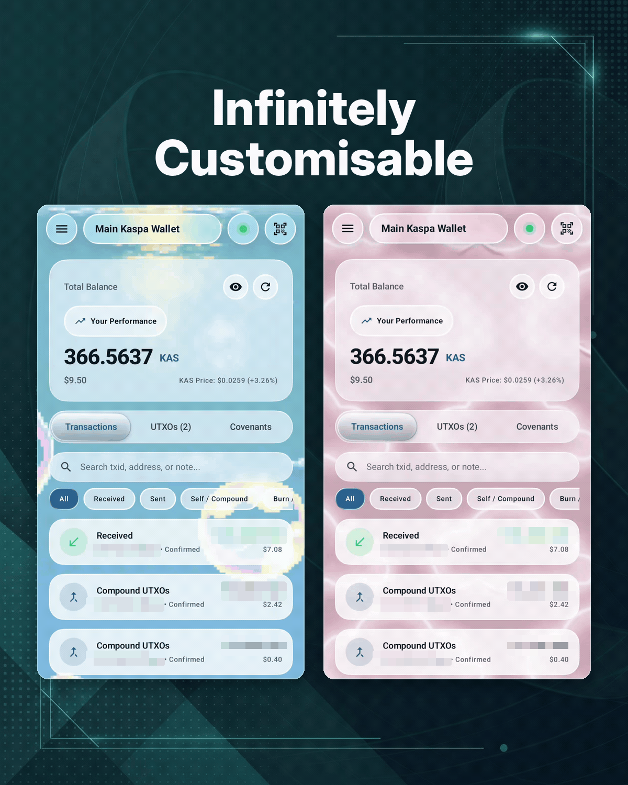
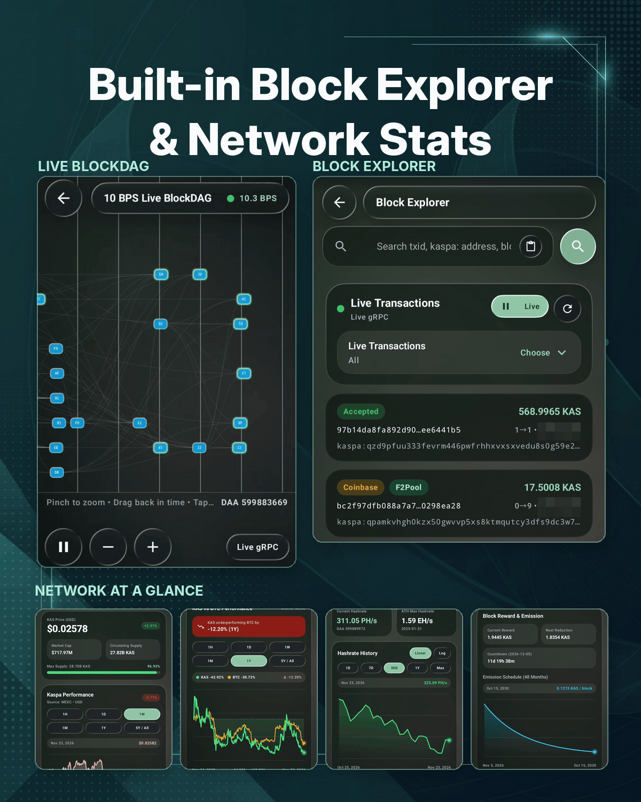
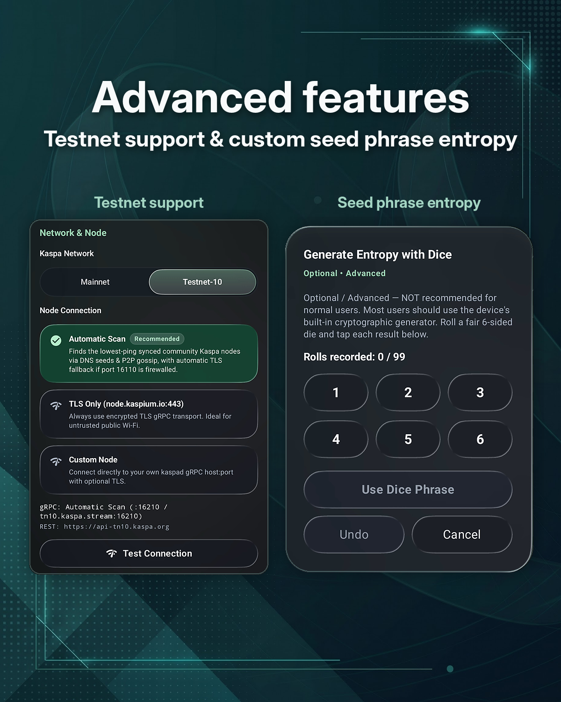
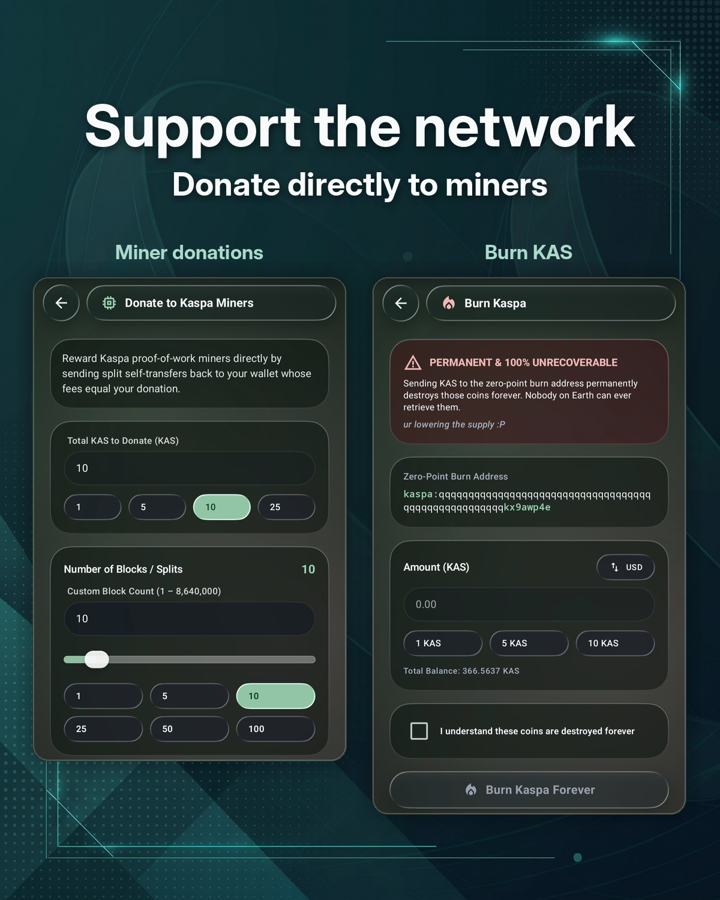

# Kaspa Kinetic

A pure Layer-1, self-custodial, open-source Android wallet and SilverScript Covenants platform for **Kaspa**, written in Kotlin and Jetpack Compose with the Kinetic Aero UI.

- **License:** [GNU General Public License v3.0 (GPLv3)](LICENSE)
- **Current Release:** `v1.0.0-rc1` (Release Candidate 1)
- **Platform:** Android 9.0+ (`minSdk 28`, `targetSdk 35`) — zero Google Play Services required

> **Release Candidate Notice (`v1.0.0-rc1`):** Kaspa Kinetic `1.0.0-rc1` is a public Release Candidate. While the wallet core, Toccata Transaction v1 engine, on-device Script VM, and all 7 Layer-1 Covenants are backed by an automated test suite and multi-device testing, please test flows on **Testnet-10** first before locking large Mainnet balances, and always back up both your seed phrase and your `.kinetic` backup file.

---

## Showcase

### Clean, Fast Kaspa Layer-1 Interface
<p align="center">
  
</p>

### Native Pre-Made Consumer Covenants
<p align="center">
  
</p>

### Kinetic Aero Themes & Live Customization
<p align="center">
  
</p>

### Built-In Block Explorer, Network Stats, & 10 BPS BlockDAG
<p align="center">
  
</p>

### Advanced Self-Custody & L1 Power Tools
<p align="center">
  
</p>

### Support the Kaspa Network
<p align="center">
  
</p>

---

## Key Features

### Self-Custodial Kaspa Layer-1 Wallet
- **Full BIP-39 / BIP-32 HD Support:** 12- and 24-word wallet generation (CSPRNG or physical dice-roll entropy), 12/15/18/21/24-word seed import with optional BIP-39 passphrase and legacy 12-word compatibility, BIP-340 Schnorr signing, and KIP-5 personal message sign/verify.
- **Watch-Only Cold Storage:** Import `kpub`, `ktub`, `xpub`, `tpub`, BIP-380 descriptors, raw Ledger APDU hex (`4104...`), or standalone Kaspa addresses.
- **Hardware-Backed Security:** Android Keystore / StrongBox AES-256-GCM encrypted seed vault, 6-digit PIN + BiometricPrompt unlock, auto-lock timeouts, `FLAG_SECURE`, and screenshot detection.
- **Direct `kaspad` gRPC Networking:** Persistent bidirectional HTTP/2 `MessageStream` with a 3-tier decentralized node pool (`Automatic Scan`), `TLS Only`, and `Custom Node` support across Mainnet and Testnet-10.
- **Complete L1 Utilities:** Multi-wallet management, UTXO inspector & one-tap UTXO compounding, KNS `.kas` / `.k` resolution, Contacts book, CSV transaction export, Burn Kaspa, and Donate to Kaspa Miners.

### Native Kaspa Layer-1 Covenants (Toccata v1)
All 7 consumer covenants compile directly on-device into Kaspa Script P2SH bytecode with `SilAbiArtifact` v1 metadata, unique per-vault salt, and pre-broadcast verification inside the on-device `KaspaScriptVm`:
1. **Hodl Time-Lock:** Absolute `tx.time` CLTV lock until your chosen date and time.
2. **Daily Spend Limit:** Stateful KIP-20 vault enforcing a capped allowance per reset window with immediate Day-1 spending, live availability readout, and a full-withdraw bypass date.
3. **Clawback Vault:** Two-stage KIP-20 security vault with a withdrawal delay period and zero-delay **Instant Alarm Clawback** straight to a hardcoded recovery address.
4. **Goal-Locked Piggy Bank:** Unlocks when your vault hits its target KAS savings goal, paired with a fallback unlock date so funds can never be stuck permanently.
5. **Dead Man's Switch:** Fixed-address relative `OP_CHECKSEQUENCEVERIFY` vault. Owner check-ins spend back to the exact same P2SH address (resetting the inactivity timer without invalidating the heir's `.kpass` and paying fees from normal wallet UTXOs when available); if the owner stops checking in, the heir can claim the full balance with `0.00 KAS`.
6. **Recurring Allowance / Subscription:** Self-advancing `tx.time` CLTV pool paying a fixed amount each cycle with deterministic schedule progression, keyless `0.00 KAS` recipient claiming via `.kpass`, and owner `Cancel & Reclaim` anytime.
7. **Cold-Only Address Whitelist:** Locks funds so they can only ever move to 1–3 pre-approved cold addresses, supporting partial spends and full-balance `Max` sweeps.

### Encrypted Backups, Recovery, & Keyless `.kpass` Sharing
- **`.kinetic` Encrypted Archives:** Open, documented AES-256-GCM backup format ([`KINETIC_BACKUP_FORMAT.md`](KINETIC_BACKUP_FORMAT.md)) with automatic per-wallet snapshots and optional SAF auto-sync.
- **On-Chain `KKCV1` Recovery:** Seed-encrypted recovery payloads attached to covenant deployments and owner state transitions for archival BlockDAG scans.
- **Shareable `.kpass` Claim Passes:** Deterministic, public-safe JSON files and compact QR codes for Dead Man's Switch heirs and Subscription recipients (zero private keys).
- **Universal `--utxoindex` Node Support:** Works seamlessly on standard Kaspa full nodes even when `--covenant-index` is not enabled.

### Explorer, Analytics, Offline QR Scanner, & Localization
- **Built-In Block Explorer & Analytics:** Transaction/block/address/KNS lookup, live `NotifyBlockAdded` feed, real-time 10 BPS interactive BlockDAG visualizer, Market & KAS-vs-BTC charts, Network & Mining metrics, paginated Top 10,000 Rich List, and 100% local personal portfolio analytics (`Your Performance` + `Set Goal`).
- **Offline Brand-Independent QR Scanner:** Built-in `CameraX` + `zxing-cpp` live camera and gallery image QR scanning with zero Google Play Services / ML Kit dependency.
- **11 Languages:** English, Simplified Chinese, Traditional Chinese, Japanese, Korean, Arabic (RTL), Spanish, French, German, Portuguese, and Russian.

---

## Building from Source

### Prerequisites
- JDK 17
- Android SDK (`compileSdk 35`, Build Tools `35.0.0`)

### Run Unit Tests
```bash
./gradlew testDebugUnitTest --no-daemon
```

### Build Debug APK
```bash
./gradlew assembleDebug --no-daemon
```
Output: `app/build/outputs/apk/debug/app-debug.apk`

### Build Release APK
To build an unsigned release APK:
```bash
./gradlew assembleRelease --no-daemon
```

To build a signed release APK, either create a gitignored `keystore.properties` in the project root:
```properties
storeFile=/path/to/your-release-keystore.jks
storePassword=YOUR_STORE_PASSWORD
keyAlias=YOUR_KEY_ALIAS
keyPassword=YOUR_KEY_PASSWORD
```
or pass environment variables `KK_KEYSTORE_PATH`, `KK_KEYSTORE_PASS`, `KK_KEY_ALIAS`, and `KK_KEY_PASS`, then run `./gradlew assembleRelease --no-daemon`.

---

## Security & Privacy Notes

- **100% Client-Side Custody:** Seeds and private keys never leave your device and are encrypted at rest via Android Keystore / StrongBox (`AES-256-GCM`).
- **No Telemetry or Analytics:** Zero tracking SDKs, zero Google Play Services, and a `KAS Only Privacy Mode` switch in Settings that disables all external market/fiat price requests.
- **`.kpass` Privacy Note:** `.kpass` files and QR codes contain **zero** private keys or seed material, but they do include the vault's on-chain P2SH address, payout destination, schedule, and balance metadata. Share them only with the intended heir or recipient.

---

## Links & Licensing

- **GitHub:** https://github.com/KaspaKinetic/Kaspa-Kinetic
- **X (Twitter):** https://x.com/KaspaKinetic
- **Email:** kaspakinetic@gmail.com
- **License:** [GNU General Public License v3.0 (GPLv3)](LICENSE). Third-party attributions are documented in [`NOTICE`](NOTICE), [`LICENSE-KASPIRE-APACHE-2.0`](LICENSE-KASPIRE-APACHE-2.0), and [`LICENSE-KASPIUM-MIT`](LICENSE-KASPIUM-MIT).
